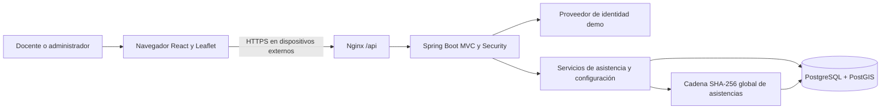

# Arquitectura

El sistema es un monolito académico: una API Java, una interfaz React y una base PostgreSQL/PostGIS independiente. No hay integración institucional real. La base inicia sin identidades, polígonos, horarios ni asistencias precargados; únicamente contiene el Génesis de la cadena y su cabecera. La autenticación local del perfil `demo` sigue siendo simulada.

La ubicación se solicita al pulsar un control. No se sigue a personas continuamente y abrir una pantalla nunca crea asistencia. React muestra la clasificación devuelta por el servidor; PostGIS determina la pertenencia espacial. La identidad procede exclusivamente de la sesión autenticada.

Los paquetes raíz son `controllers`, `dto`, `services`, `repositories`, `models`, `config`, `exceptions` y `utils`; las capas de dominio se subdividen por funcionalidad. Un Controller recibe HTTP y DTO; un Service aplica las reglas y define la transacción; un Repository/JPA persiste entidades. Las consultas SQL espaciales aprovechan PostGIS directamente. Los records de `dto` describen la entrada/salida pública y las entidades de `models` representan datos persistidos.

Antes de validar las entidades con Hibernate, `DatabaseInitializationConfig` coordina el arranque mediante un bloqueo transaccional PostgreSQL. Crea el esquema desde `schema.sql` si falta `global_chain_head` y llama a `GenesisService` para garantizar el bloque inicial y su cabecera. No hay migraciones ni carga automática de ejemplos.

La asistencia, su bloque y la cabecera global se guardan en una única transacción. Un bloqueo de fila por docente protege idempotencia y duplicados; después, el bloqueo de la única cabecera global serializa el encadenamiento entre todos los docentes, incluso con varias instancias Java. La restricción docente/ocurrencia y la clave de idempotencia previenen duplicados. La geometría y configuración usadas se conservan en la evidencia para que una edición posterior no reinterprete el historial.

Las decisiones técnicas reversibles se fijan en el código y la documentación: sesión HTTP con cookies, CSRF, GeoJSON Polygon WGS84, horarios en America/Mexico_City y eventos centralizados con SHA-256. La ventana y los criterios de calidad son valores de demostración configurables; no representan reglas administrativas de UdeG.
