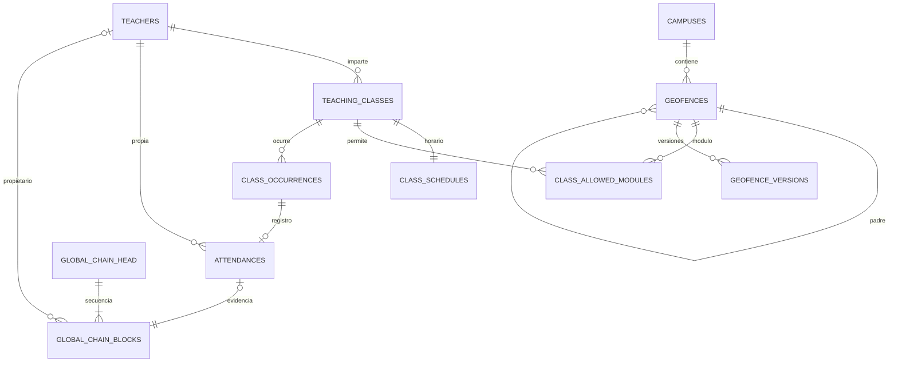

# Base de datos

Se usa PostgreSQL 16 con PostGIS 3.5, en un servicio independiente. El digest de la imagen en Compose fija el contenido descargado. Hibernate es el ORM: mapea entidades Java y ejecuta persistencia sobre PostgreSQL; no es una base embebida. No se usa H2.

`config/DatabaseInitializationConfig.java` inicializa la base antes de que Hibernate valide las entidades. Adquiere un bloqueo transaccional de PostgreSQL y, si no existe `global_chain_head`, aplica el único esquema consolidado `backend/src/main/resources/schema.sql`. Después `services/chain/GenesisService.java` garantiza un solo Génesis y su cabecera dentro de esa inicialización. Hibernate conserva `ddl-auto: validate`. No se usa Flyway ni se cargan datos semilla.

`teachers` conserva el código como `varchar(7)` con una restricción de siete dígitos. `campuses` permite extender el piloto a otros campus. `geofences` almacena la geometría real y su relación padre/hijo; un trigger sincroniza la columna espacial desde GeoJSON y valida el polígono. `geofence_versions` conserva configuraciones anteriores.

Una clase tiene horario semanal y varios módulos permitidos mediante una tabla de unión. Una ocurrencia representa una fecha concreta y guarda inicio/fin como `timestamptz`. Una asistencia referencia esa ocurrencia y almacena recepción, clasificación temporal/espacial, justificación, ubicación nullable, configuración y payload de cadena.

Las restricciones únicas impiden repetir una asistencia para el mismo docente/ocurrencia y reutilizar una clave de idempotencia en ese docente. `global_chain_blocks` tiene índice global único y asistencia única. El bloque 0 es el único génesis, sin docente/asistencia/fecha; los demás requieren esos campos. `global_chain_head` contiene una sola fila de id 1 con último índice/hash y total de bloques (último índice + 1). Los índices GiST aceleran operaciones espaciales; índices por docente y fecha facilitan historial.

La escritura bloquea el docente antes de comprobar duplicados y después la cabecera global antes de agregar un bloque. Esto serializa también registros de docentes distintos. El commit persiste asistencia, bloque y cabecera juntos; un error revierte los tres. No borrar o editar bloques con herramientas de administración del prototipo.

Una base nueva contiene únicamente el Génesis global y la cabecera. Docentes, campus, geocercas, clases y asistencias permanecen vacíos hasta las acciones explícitas del usuario. No se conservan tablas de cadenas antiguas ni se importan datos anteriores. Este inicializador no actualiza esquemas existentes: si se cambia la estructura, hay que definir expresamente cómo aplicarla; para este reinicio se recrea la base local. Véase [la cadena y su génesis](cadena-de-bloques.md).

Compose crea el volumen `metodologia-geocercas_postgres_data`. `docker compose restart` y `docker compose down` conservan sus datos. Un reinicio deliberado con `docker compose down -v` elimina el volumen del proyecto; el siguiente arranque crea el esquema y un único Génesis. No hay scripts de carga de pruebas ni resultados sintéticos guardados.
