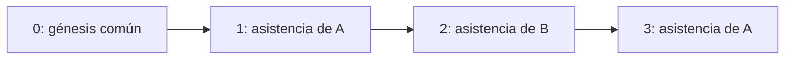

# Cadena criptográfica global de asistencias

Todos los docentes comparten una sola secuencia SHA-256, identificada como `GLOBAL_ATTENDANCE`. Cada asistencia crea un bloque que incluye el hash del bloque anterior, aunque ese registro pertenezca a otra persona. Iniciar sesión, comprobar ubicación o reenviar una asistencia ya guardada no crea bloques.



## Hash cero

`services/chain/GenesisService.java` crea una sola vez el bloque `GENESIS`, de índice 0 y UUID `00000000-0000-0000-0000-000000000000`, junto con la cabecera global. `config/DatabaseInitializationConfig.java` lo invoca al arrancar, después de inicializar el esquema y antes de la validación de Hibernate. La inicialización usa un bloqueo transaccional PostgreSQL para coordinar arranques concurrentes. No representa una asistencia: docente, asistencia y fecha de recepción son null. Su payload es `{"phrase":"And they say chivalry is dead"}` y su hash anterior contiene 64 ceros.

El hash inicial se calcula directamente sobre los bytes UTF-8 de la frase exacta, respetando mayúsculas y espacios, sin comillas ni salto final:

```text
SHA-256("And they say chivalry is dead")
= 47b7663559093619c363151c5e8395df979fb7595b9cde94d1f70f22d5356945
```

La primera asistencia tiene índice 1 y usa ese digest como `previousHash`. La frase se utiliza solamente para el génesis común; cambiar de docente no inicia otra cadena. Los reinicios no vuelven a insertar el bloque cero.

## Serialización v2 de cada asistencia

Cada bloque de asistencia conserva UUID, identificador global de cadena, docente propietario, índice, tipo `ATTENDANCE_RECORDED`, asistencia, fecha del servidor, payload, hash anterior/actual y versión de formato 2. `CanonicalJson.hashGlobalBlock` construye una envoltura JSON con claves en orden lexicográfico:

```text
attendanceId, blockId, chainId, eventType, formatVersion, index,
payload, previousHash, serverAt, teacherId
```

También ordena recursivamente las claves del payload. Los arrays conservan su orden; las listas de referencias de configuración se ordenan por identificador. La entrada al SHA-256 es UTF-8, sin espacios de formato ni salto final. Los strings usan las reglas de escape JSON de Jackson. Los números se normalizan con BigDecimal, sin ceros decimales finales ni exponente; el cero negativo se representa como 0. UUID y fechas son cadenas ISO-8601; los instantes usan UTC y precisión de microsegundos para coincidir con PostgreSQL. Los booleanos son `true/false` y la ausencia explícita es `null`. El digest es hexadecimal minúsculo de 64 caracteres.

```text
hash = hex_minúscula(SHA-256(UTF-8(JSON_canónico(envoltura))))
```

El génesis es la excepción explícita a esa fórmula: su digest es el de la frase cruda. El payload de cada asistencia incluye identidad local, clase, ocurrencia, campus, ubicación o ausencia, precisión/captura, recepción, clasificación espacial/temporal, estado y justificación, junto con la política y versiones de configuración usadas. El historial no reinterpreta registros usando geocercas nuevas.

## Transacción y concurrencia

La transacción bloquea primero la fila del docente para comprobar idempotencia y duplicados. Después bloquea con `SELECT FOR UPDATE` la fila única de `global_chain_head`, lee el último índice/hash, agrega el bloque y actualiza la cabecera. Ese segundo bloqueo serializa las asistencias de todos los docentes, incluso con varias instancias Java. La escritura usa READ_COMMITTED; el índice refleja el orden de encadenamiento, sin prometer orden por captura GPS.

Asistencia, bloque y cabecera se confirman juntos; un fallo revierte los tres. Una solicitud rechazada o duplicada no genera otro bloque. No hay endpoints para editar o borrar bloques. Una futura corrección administrativa debe agregar otro evento que conserve la evidencia original; este prototipo solamente produce eventos de registro.

## Inicialización limpia

El esquema está consolidado en `backend/src/main/resources/schema.sql`, sin migraciones Flyway, tablas antiguas ni datos de ejemplo. Solo se aplica si falta la tabla `global_chain_head`. La creación del Génesis es idempotente: los reinicios no generan otro bloque ni reinician una cadena que ya contiene asistencias.

El entorno se reinicia con base vacía; no se importan asistencias anteriores. Tras crear el esquema, solo existen el bloque de índice 0 y su cabecera. Los registros posteriores se originan exclusivamente en acciones explícitas del usuario.

## Consulta, privacidad y verificación

`GET /api/chain` devuelve cabecera y total globales, frase/hash inicial y solamente el génesis junto con los bloques propios de la sesión. Los saltos entre índices visibles corresponden a asistencias de otros docentes cuyos payloads no se entregan. Por ello el navegador no reconstruye toda la secuencia por sí mismo.

`GET /api/chain/verify` comprueba la cadena global completa en el servidor: génesis/frase/hash cero, secuencia de índices, enlaces, versión y eventos, recálculo de cada hash y correspondencia con su asistencia. Coteja recepción, identidad, ocurrencia, ubicación, estado, resultados y justificación; comprueba configuración archivada, cantidad de asistencias y cabecera. Devuelve `valid`, `checkedBlocks` y `firstError`, sin exponer datos de otros docentes. `checkedBlocks` cuenta los bloques examinados hasta terminar o detectar el primer error, incluido el génesis.

Un JSON roto se muestra como texto en la inspección propia y produce un error de integridad comprensible.

## Alcance del resultado

La cadena es centralizada, con fines académicos. Una verificación válida indica consistencia interna de la evidencia conservada; no prueba la verdad de una ubicación, crea una firma del docente ni garantiza inmutabilidad absoluta. Quien controle totalmente la base puede reescribir datos y recalcular la cadena. Eliminar el final y ajustar registros/cabecera puede resultar indetectable sin una referencia externa confiable. Una ampliación podría publicar periódicamente cabeceras firmadas en almacenamiento independiente.
