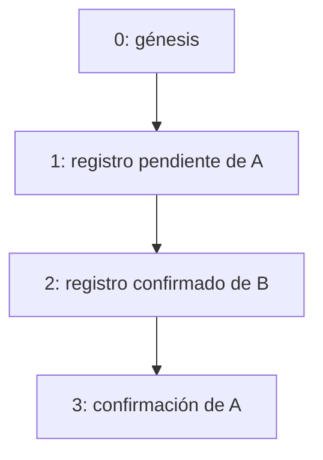

# Cadena criptográfica global de asistencias

Todos los docentes comparten una secuencia SHA-256 identificada como GLOBAL_ATTENDANCE. Cada movimiento efectivo de asistencia agrega un bloque: el registro inicial y la confirmación posterior de un pendiente. La revisión conserva el bloque original; no lo reemplaza ni recalcula sus datos.



## Génesis y formato

`GenesisService` crea una sola vez el bloque GENESIS de índice 0, UUID `00000000-0000-0000-0000-000000000000`, y la cabecera global. Docente, asistencia y fecha son null; el payload es `{"phrase":"And they say chivalry is dead"}` y el enlace anterior contiene 64 ceros.

El digest inicial usa únicamente los bytes UTF-8 de la frase, respetando mayúsculas y espacios, sin comillas ni salto final:

```text
SHA-256("And they say chivalry is dead")
= 47b7663559093619c363151c5e8395df979fb7595b9cde94d1f70f22d5356945
```

Desde el índice 1 se conserva el formato 2. `CanonicalJson.hashGlobalBlock` calcula SHA-256 sobre una envoltura JSON con estas claves en orden lexicográfico:

```text
attendanceId, blockId, chainId, eventType, formatVersion, index,
payload, previousHash, serverAt, teacherId
```

También ordena recursivamente las claves del payload. Los arrays mantienen el orden; las referencias de configuración se ordenan por identificador. Usa UTF-8, sin espacios de presentación ni salto final, escapes JSON de Jackson y números normalizados con BigDecimal, sin exponente ni ceros decimales finales. El cero negativo se representa como 0. Los instantes usan UTC con microsegundos; los hashes son hexadecimales minúsculos de 64 caracteres.

El génesis conserva su excepción: su digest es el de la frase cruda. La actualización no reescribe los hashes v2 anteriores.

## Eventos

| Evento | Cuándo se agrega | Evidencia |
|---|---|---|
| GENESIS | Inicialización de una base nueva | Frase y hash inicial |
| ATTENDANCE_RECORDED | Registro de una asistencia nueva | Identidad, ocurrencia, ubicación, clasificación, estado inicial, justificación y configuración |
| ATTENDANCE_STATUS_CHANGED | Confirmación efectiva de un pendiente | Asistencia, estado anterior/nuevo, responsable, rol, fecha y comentario |

El docente propietario permanece en teacherId de la envoltura incluso cuando el movimiento lo realiza un jefe. El autor de la revisión se conserva dentro del payload. Dos eventos de la misma asistencia comparten attendanceId y tienen UUID, índice, fecha y hash propios.

Login, consultas, comprobación de ubicación, alta de clases/jefes y reintentos no agregan bloques. La transición admitida es PENDING_REVIEW → CONFIRMED con comentario obligatorio. Una confirmación repetida devuelve el estado actual sin agregar otro movimiento.

## Transacción y concurrencia

El registro bloquea primero la fila del docente para comprobar idempotencia y duplicados. La revisión toma el mismo bloqueo y vuelve a leer el estado antes de decidir si hay una transición. Después se bloquea la única fila de global_chain_head mediante SELECT FOR UPDATE para asignar índice y enlace.

Este orden serializa movimientos del mismo docente y la cabecera serializa eventos de todos los docentes, incluso con varias instancias Java. Estado, bloque y cabecera se confirman juntos; un fallo revierte la operación. No existen endpoints de edición o borrado de bloques.

La base conserva una sola asistencia por docente/ocurrencia y una clave de idempotencia única por docente. La tabla de bloques permite varios eventos por asistencia. Un registro no debe confundirse con el número de movimientos que produjo.

## Consulta y verificación

GET `/api/chain` y GET `/api/chain/verify` son exclusivos de ADMIN. La consulta devuelve génesis, todos los bloques y sus payloads completos. JEFE consulta únicamente las asistencias autorizadas; el docente consulta su registro y un historial funcional con fecha, estados, responsable y comentario, sin hashes ni payloads.

El verificador lee con REPEATABLE_READ y comprueba génesis, índices consecutivos, enlaces, formato, tipo de evento y hash recalculado. Para ATTENDANCE_RECORDED conserva la comparación contra el snapshot original y los datos espaciales/temporales. Reconstruye el estado por asistencia al recorrer los eventos, valida las transiciones y finalmente compara el estado reconstruido con el registro actual. Una confirmación válida no invalida el estado pendiente guardado en el primer bloque.

El conteo de asistencias se coteja contra eventos iniciales, mientras que la cabecera se coteja contra todos los bloques. Se conserva la comprobación de versiones de geocerca. La respuesta es `{valid,checkedBlocks,firstError}`; checkedBlocks incluye el génesis y termina al detectar el primer error.

## Actualización y alcance

`DatabaseInitializationConfig` aplica el esquema nuevo o su actualización compatible antes de validar Hibernate, bajo bloqueo transaccional PostgreSQL. Los datos y hashes existentes se conservan. No es necesario eliminar el volumen. Las clases anteriores sin creador quedan bajo acceso de ADMIN.

La cadena es centralizada y académica, sin consenso distribuido. Una verificación válida indica consistencia interna; no demuestra presencia física, identidad institucional ni inmutabilidad absoluta. Quien controla toda la base puede reescribir la evidencia y recalcularla. Detectar la eliminación del final requiere una referencia externa confiable.
